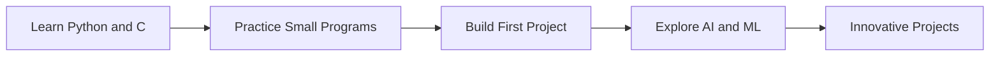

<h1 align="center">Hi 👋, I'm SATHVIC</h1>

  

  
  

---

## 🎓 About Me

| | |
|---|---|
| 🏫 **College** | BMSIT |
| 📚 **Branch** | AIML (1st Year) |
| 🌱 **Learning** | Python, C |
| 🎯 **Goal** | Building innovative projects |
| 📫 **Contact** | sathvicbusiness@gmail.com |

---

## 🛠️ Skills

  

| Skill | Level |
|-------|-------|
| 🐍 Python |  |
| ⚙️ C |  |
| 🤖 AI / ML |  |

---

## 🗺️ My Journey

---

## 📌 Current Focus

- [x] Created my GitHub account
- [ ] Learn Python and C basics
- [ ] Upload my first project
- [ ] Build something innovative

---

## 📫 Connect With Me

  
  

⭐ Thanks for visiting my profile!

