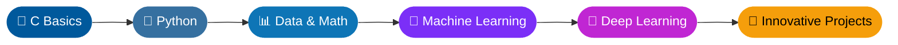

<!-- ========== HEADER BANNER ========== -->

<!-- ========== TYPING ANIMATION ========== -->

  

  
  
  

 

<!-- ========== ABOUT AT A GLANCE ========== -->
## 🧭 At a Glance

| 🎓 Studying | 🌱 Learning | 🎯 Goal | 💬 Ask me about |
|:---:|:---:|:---:|:---:|
| **AIML @ BMSIT** | **Python • C** | **Innovative projects** | **Python • C • AI** |

 

<!-- ========== TECH STACK ========== -->
## 🛠️ Tech Stack

  

 

<!-- ========== LEARNING ROADMAP (renders natively on GitHub) ========== -->
## 🗺️ My Learning Roadmap

 

<!-- ========== GITHUB STATS ========== -->
## 📊 GitHub Stats

  
  

  

 

<!-- ========== CONTRIBUTION GRAPH ========== -->
## 📈 Contribution Graph

  

 

<!-- ========== TROPHIES ========== -->
## 🏆 Trophies

  

<!-- ========== OPTIONAL: SNAKE ANIMATION ==========
Uncomment this block AFTER setting up the GitHub Action (see instructions).

  

-->

 

<!-- ========== CONNECT ========== -->

### 📫 Let's Connect

*⭐ Always learning, always building.*

